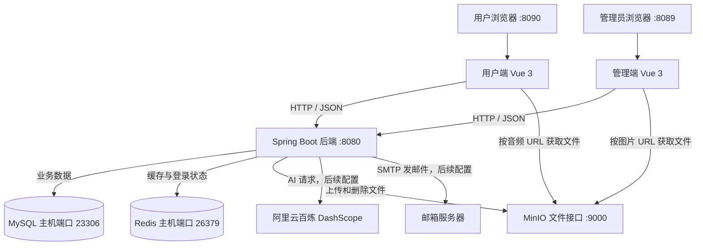
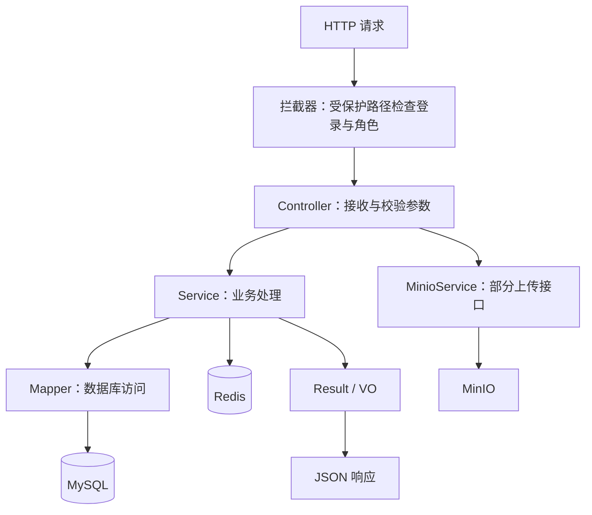
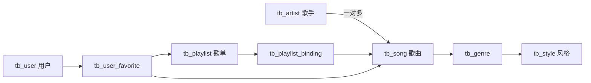

# Vibe Music 技术栈与架构学习指南

> 根据 `D:\code\vibe-music` 当前本地代码整理，日期：2026-10-28。
> 阅读目标：知道项目由哪些程序组成、每项技术解决什么问题，以及怎样顺着代码看懂一个功能。
> 本文分析代码实现，不代表所有功能已在本机逐项测试。你当前先运行音乐基础功能；AI 和邮件仍需后续配置。

## 1. 先用一句话认识项目

这是一个在线音乐网站：用户在网页听歌、搜索、收藏和评论；管理员在另一套网页维护歌曲、歌手、歌单和用户；两套网页共用一个 Java 后端。

先记住这张分工表：

| 部分 | 负责什么 | 好理解的例子 |
| --- | --- | --- |
| 用户端 Vue 网页 | 把功能展示给听歌用户 | 播放按钮、搜索框、收藏列表 |
| 管理端 Vue 网页 | 让管理员维护内容 | 新增歌曲、修改封面、禁用账号 |
| Spring Boot 后端 | 校验请求、执行业务、组织返回数据 | 判断密码正确与否、查询某首歌 |
| MySQL | 长期保存结构化业务数据 | 歌名、用户、收藏关系、音频地址 |
| Redis | 保存缓存和短期状态 | 登录令牌、验证码、推荐列表 |
| MinIO | 保存音频、图片等文件 | 一首歌的音频、专辑封面、头像 |
| 百炼模型服务 | 根据提示生成 AI 回复 | 理解“帮我找几首摇滚歌曲” |

**最容易混淆的是：MySQL 记录“歌曲是什么、文件在哪里”，MinIO 保存“真正的音频文件”。**

## 2. 整体架构：两个前端，一个后端，三个基础服务



图里的端口对应当前本地启动方案。MinIO 的 `9001` 是管理员控制台，`9000` 才是程序上传文件、浏览器读取音频的接口。

### 2.1 “前后端分离”是什么意思？

前端用 Vue 编写页面，后端用 Java 编写接口，两边通过 HTTP 交换数据。

例如：页面发送“查询歌曲列表”的请求，Java 后端返回 JSON；页面收到 JSON 后，把歌名、歌手、封面显示出来。Java 后端通常不直接生成这个网页。

### 2.2 是微服务吗？

当前代码属于**Maven 多模块的单体应用**。

`server`、`model`、`common` 是代码和构建上的模块划分，最终主要运行一个 Spring Boot 后端进程。用户端和管理端也没有各自独立的 Java 后端。

MySQL、Redis、MinIO 是这个应用依赖的服务。它们独立运行，不等于项目已经拆成订单服务、用户服务那样的业务微服务。

### 2.3 当前本机怎样部署？

| 程序 | 当前运行方式 | 主要入口 |
| --- | --- | --- |
| 用户端 | 本机 Vite 开发服务器 | `http://localhost:8090` |
| 管理端 | 本机 Vite 开发服务器 | `http://localhost:8089` |
| Java 后端 | 本机 Java 进程，可用 IDEA 启动 | `http://localhost:8080` |
| MySQL | Docker 容器 | 本机 `23306` → 容器 `3306` |
| Redis | Docker 容器 | 本机 `26379` → 容器 `6379` |
| MinIO | 本机可执行程序 | 文件接口 `9000`，控制台 `9001` |

当前 `compose.local.yml` 管理 MySQL 和 Redis；MinIO 由本地启动方案单独启动。不要把“安装了 Docker”理解成所有程序都已经装进 Docker。

启动操作继续参考 [Windows 本地启动说明](D:/code/vibe-music/Windows本地启动说明.md)。本文主要讲原理和代码结构。

## 3. 后端技术栈：逐项理解它有什么用

下列版本来自当前 POM 声明；前端带 `^`、`~` 的版本是允许安装的范围，不等于锁文件中每个包的精确安装版本。

| 技术 | 当前声明 | 在项目里的具体作用 | 先学什么 |
| --- | --- | --- | --- |
| Java | 17 | 编写所有后端业务 | 类、接口、集合、异常、Stream |
| Spring Boot | 3.5.16 | 组织和启动后端，集成 Web、数据库等组件 | 启动类、配置文件、依赖注入 |
| Spring MVC | Web starter 引入 | 把 HTTP 请求交给 Controller，接收参数并返回 JSON | `@RestController`、请求映射、参数绑定 |
| Maven | 多模块构建 | 下载依赖、管理模块、打包后端 | `pom.xml`、dependencies、modules |
| MyBatis-Plus | 3.5.9 | 对数据库做增删改查，支持分页和条件查询 | `BaseMapper`、`QueryWrapper`、`Page` |
| MyBatis XML / SQL 注解 | 随数据层使用 | 写歌曲与歌手的关联查询、详情和推荐查询 | JOIN、LIKE、动态 SQL、resultMap |
| MySQL | 本地镜像 8.0.33 | 保存歌曲、用户、歌单、评论等数据 | 表关系、索引、事务 |
| Druid | 1.2.24 | 复用数据库连接 | 连接池为什么能减少连接开销 |
| Spring Data Redis | starter 引入 | 让 Java 读写 Redis | StringRedisTemplate、RedisTemplate |
| Spring Cache | 注解缓存机制 | 查询结果缓存、修改后清理缓存 | `@Cacheable`、`@CacheEvict` |
| java-jwt | 4.4.0 | 生成和校验 JWT 登录令牌 | 签名、过期时间、claims |
| 自定义 MVC 拦截器 | 项目代码 | 检查令牌和角色是否能访问接口 | `preHandle`、`afterCompletion` |
| ThreadLocal | Java 类 | 在当前请求线程内保存用户信息 | set/get/remove、请求结束清理 |
| MinIO Java SDK | 8.5.9 | 上传、删除音频和图片 | bucket、object、文件 URL |
| Jakarta Validation | validation starter | 校验接收的参数 | `@Valid`、DTO 上的校验注解 |
| Jakarta Mail / Angus | POM 引入 | 连接 SMTP 邮箱服务器发送验证码 | SMTP、邮箱授权码 |
| Lombok | 父 POM 引入 | 减少 getter/setter、日志字段等样板代码 | 能看懂注解生成了什么 |
| Jackson | Web 与缓存配置使用 | JSON 与 Java 对象互转、Redis 值序列化 | 序列化和反序列化 |
| Spring AI | BOM 1.1.2 | 统一组织模型调用、工具调用、会话记忆 | ChatClient、Tool、Memory |
| Spring AI Alibaba | 1.1.2.0 | 接入百炼 DashScope 模型 | 模型配置和工具注册 |
| Reactor Flux + SSE | AI 接口中使用 | 把 AI 回复分段传给网页 | 流式响应是什么 |

注意：虽然依赖里引入了 Alibaba Agent Framework，当前 AI 入口主要使用 `ChatClient + tools + memory`。不能仅凭依赖名称就认定它已经实现多智能体协作。

### 3.1 Spring Boot、Spring MVC、MyBatis-Plus 怎么配合？

拿“查询歌曲”举例：

1. Spring Boot 把后端启动起来，并管理所需对象。
2. Spring MVC 找到处理该地址的 `SongController`。
3. Controller 调用 `SongServiceImpl` 执行业务。
4. Service 通过 Mapper 和 SQL 查询 MySQL。
5. 查询结果被转换为前端需要的对象，再序列化为 JSON。

你先理解这条线，再分别学习框架细节，会容易得多。

### 3.2 JWT、Redis、拦截器分别干什么？

JWT 是服务端签发的身份令牌；Redis 记录这个令牌是否仍然有效；拦截器是请求进入受保护接口前的检查入口。

当前受保护接口会结合 Redis 中的令牌记录和 JWT 校验做判断。因此，不能把它简单理解为“有个能解析的 JWT 就一定能访问所有接口”。公开接口另有放行逻辑，后面会讲。

当前登录机制由项目自己实现，**没有把 Spring Security 或 Sa-Token 作为这条登录链路的实现框架**。这与之前学习的商城项目要分开记。

## 4. 前端技术栈：不用一次全部学完

| 技术 | 作用 | 在网站里的表现 |
| --- | --- | --- |
| Vue 3 | 组织页面和组件 | 歌曲列表、登录弹窗、播放器 |
| TypeScript | 给 JavaScript 数据和函数增加类型约束 | 歌曲对象有哪些字段、接口返回什么类型 |
| Vite 6.x | 启动开发服务器和打包网页 | 执行 `pnpm dev` 后出现页面地址 |
| Vue Router | 管理网页内的页面切换 | 首页、歌单详情、我的收藏 |
| Pinia | 多组件共享状态 | 当前用户、播放队列、音量 |
| pinia-plugin-persistedstate | 持久化部分用户端状态 | 刷新后恢复部分播放器和用户状态 |
| Axios | 请求后端业务接口 | 登录、查询歌曲、提交收藏 |
| Element Plus | 提供现成 UI 组件 | 表格、表单、提示、弹窗 |
| Tailwind CSS、Sass | 编写样式和布局 | 页面间距、颜色、深浅主题 |
| vue-pure-admin | 管理端基础模板 | 菜单、后台布局、管理页面结构 |
| ECharts | 管理端图表展示 | 统计图表相关组件 |
| 原生 Audio API | 实际音频播放控制 | 播放、暂停、拖动进度、切歌 |
| Artplayer | 已引入并有封装组件 | 可在 `components/Artplayer.vue` 查看 |
| fetch + ReadableStream | 读取 AI 流式响应 | 回复内容逐段出现 |
| markdown-it | 展示 AI 回复中的 Markdown | 标题、列表、代码块等排版 |
| ESLint、Prettier、vue-tsc | 开发检查和格式化 | 检查代码问题、统一格式、检查类型 |
| pnpm | 安装和管理前端依赖 | `pnpm install`、运行 scripts |

**核心音频播放应先看 `useAudioPlayer.ts`。** 代码中实际使用 `new Audio(...)` 和 `HTMLAudioElement`。不要看到 package.json 有 Artplayer，就认为所有听歌操作都由 Artplayer 完成。

## 5. 目录怎么读：找到代码的入口

```text
D:\code\vibe-music
├─ vibe-music-backend
│  ├─ pom.xml                     后端父工程
│  ├─ vibe-music-server           可执行的 Spring Boot 应用
│  │  └─ src/main
│  │     ├─ java/com/vibemusic
│  │     │  ├─ controller         HTTP 接口入口
│  │     │  ├─ service/impl       业务实现
│  │     │  ├─ mapper             数据库访问接口
│  │     │  ├─ config             配置
│  │     │  ├─ interceptor        登录检查
│  │     │  ├─ handler            异常处理
│  │     │  └─ agent              AI 提示和曲库工具
│  │     └─ resources             配置文件、Mapper XML
│  ├─ vibe-music-model            Entity / DTO / VO
│  └─ vibe-music-common           工具、枚举、常量、统一返回结构
├─ vibe-music-client              用户端
├─ vibe-music-admin               管理端
├─ sql/vibe_music.sql             初始表结构和数据
├─ compose.local.yml              本地 MySQL / Redis 容器配置
├─ scripts                       本地启动、停止和初始化脚本
└─ docs                          项目文档
```

用 IDEA 打开 [后端父工程](D:/code/vibe-music/vibe-music-backend/pom.xml) 所在的文件夹，就可以同时看到三个 Maven 模块。启动类是 `VibeMusicServerApplication`。

### Entity、DTO、VO 分别是什么？

| 对象 | 服务谁 | 举例 |
| --- | --- | --- |
| DTO | 接收一次操作需要的参数 | `UserLoginDTO` 接收邮箱和密码 |
| Entity | 对应数据库数据 | `User`、`Song`、`Playlist` |
| VO | 返回页面需要展示的内容 | `SongVO` 包含歌名、歌手名、音频地址、收藏状态 |

一次查询可以理解为：**DTO 告诉后端“我要查什么”，Entity 表示数据库里的数据，VO 告诉前端“页面可以显示什么”。**

## 6. 后端内部架构：请求进入以后经过谁？



图表示主要职责。实际代码中，部分 Controller 直接调用 `MinioService`，部分 Service 自己从请求头解析 JWT；读代码时按真实调用走，不要强行认为每一个功能都严格经过相同层次。

## 7. 六条关键功能链路

### 7.1 登录：后端怎么知道我是谁？

```text
页面填写邮箱和密码
→ POST /user/login
→ UserController 校验参数
→ UserServiceImpl.login 查询 tb_user
→ 检查账号存在、状态允许登录、密码摘要一致
→ JwtUtil 签发 JWT
→ Redis 保存 token，当前有效期 6 小时
→ 返回 token，前端保存到用户状态
→ 后续请求携带 Authorization 请求头
```

受保护请求继续经过：

```text
LoginInterceptor
→ 获取 Authorization（兼容 Bearer 前缀）
→ 查询 Redis 中是否存在该 token
→ 校验 JWT 签名和过期时间
→ 根据角色和请求路径检查权限
→ 将身份信息写入 ThreadLocal
→ 放行请求
→ 请求结束后清理 ThreadLocal
```

`ROLE_USER` 和 `ROLE_ADMIN` 代表不同身份。`RolePermissionManager` 按配置的路径前缀匹配权限。

公开浏览接口由 `WebConfig` 等位置放行；并不是所有请求都会经过完整登录校验。部分公开查询还会自行解析 token，以补充收藏状态。

当前密码处理使用 MD5 摘要，这是现有实现，不能称为现代密码存储的最佳实践。后续可练习迁移到带盐的自适应密码哈希。JWT 是签名令牌，也不要把其内容理解为保密加密后的信息。

**读代码顺序：** `UserController.login` → `UserServiceImpl.login` → `JwtUtil` → `WebConfig` → `LoginInterceptor` → `RolePermissionManager`。

### 7.2 查歌与搜索：歌名和歌手从哪里来？

```text
前端提交分页和搜索条件
→ POST /song/getAllSongs
→ SongController
→ SongServiceImpl.getAllSongs
→ Spring Cache 检查是否有对应缓存
→ 缓存未命中时，通过 SongMapper 查询歌曲和歌手
→ 根据请求身份补充收藏状态
→ 返回 PageResult<SongVO>
→ 前端渲染列表
```

核心列表 SQL 在 `SongMapper.java` 中，通过歌曲表和歌手表关联，并用 `LIKE` 对歌名、歌手名、专辑名进行匹配。复杂详情及推荐 SQL 还分布在 `SongMapper.xml`。

这里使用 MySQL 查询，当前这条搜索链路没有用 Elasticsearch。分页则由 MyBatis-Plus 的 `Page`、分页插件和 Mapper 配合完成。

`@Cacheable` 在缓存命中时可以直接返回缓存结果，方法体不会照常再执行一遍。这一点对理解收藏状态为什么可能异常很关键，见第 10 节。

### 7.3 播放：Java 后端会一直把音乐传给我吗？

```text
Java 后端返回歌曲信息，其中包含 audioUrl
→ 前端把歌曲加入 AudioStore 播放队列
→ useAudioPlayer.ts 加载当前歌曲地址
→ 浏览器 Audio 对象请求该地址
→ MinIO 文件接口返回音频数据
→ 浏览器负责解码、播放、暂停和进度控制
```

因此，歌曲列表接口返回成功，并不代表音频文件一定存在。MySQL 里的 URL 如果指向缺失文件或无法访问的地址，就可能出现“能看到歌曲，但不能播放”。

这也是初始 SQL 已导入后仍可能需要补齐媒体资源的原因。当前本地方案已经加入用于验证播放链路的测试音频，完整原始曲库资源需要另行导入。

浏览器还可能发送 Range 请求读取文件的一部分，看到 `206 Partial Content` 不一定是错误。音频地址、响应内容和浏览器播放状态要一起看。

### 7.4 上传音频：文件和数据库如何配合？

以管理端替换歌曲音频为例：

```text
管理端选择文件、歌曲 ID 和时长
→ PATCH /admin/updateSongAudio/{id}
→ AdminController 接收 MultipartFile
→ MinioServiceImpl.uploadFile
→ 生成 songs/UUID-原文件名 形式的对象名
→ MinioClient.putObject 将文件上传到 bucket
→ 返回可访问的文件 URL
→ SongServiceImpl.updateSongAudio 更新 MySQL 中的地址和时长
→ 清理相关歌曲缓存
```

数据库保存的是文件地址。真正的音频保存在 MinIO 的对象中。

要注意：MySQL 事务不能自动撤销已经成功的 MinIO 上传。上传成功、数据库更新失败时，需要额外补偿清理；这可以成为之后的练习目标。

### 7.5 收藏与推荐：推荐是怎么选歌的？

收藏操作的主要路径是：

```text
点击收藏
→ POST /favorite/collectSong
→ UserFavoriteController
→ UserFavoriteServiceImpl
→ 向 tb_user_favorite 写入用户与歌曲的收藏关系
→ 清理相关注解缓存
→ 前端刷新收藏状态
```

推荐接口 `GET /song/getRecommendedSongs` 的实际主要逻辑是：

1. 未登录时返回随机歌曲。
2. 已登录但没有收藏歌曲时，也返回随机歌曲。
3. 查询收藏歌曲的风格，通过 `tb_genre` 找到关联的风格 ID。
4. 统计这些风格的出现次数，生成风格 ID 列表。
5. 按这些风格查询候选歌曲，排除已收藏歌曲，候选上限为 80 首。
6. 将候选列表保存到 Redis，键形如 `recommended_songs:用户ID`，有效期 30 分钟。
7. 打乱候选顺序，最多选出 20 首，不足时尝试用随机歌曲补充。

**这更适合叫“基于收藏风格的规则推荐”。** README 提到了听歌历史，但当前这段服务端推荐实现的主要输入是收藏数据。

还有一个细节：Java 中对风格频率排了序，但 SQL 使用风格 ID 的 `IN` 条件筛选，最终按歌曲发布时间排序。`IN` 不会自动保留参数列表的偏好顺序，因此不能说这里已经实现了严格的风格权重排序。

### 7.6 AI 助手：怎样回答真实曲库里的问题？

这部分源码已存在，本机真实模型调用仍待你配置 API Key。

```text
用户输入“推荐几首摇滚歌曲”
→ 前端 fetch POST /agent/chat
→ AgentController 使用 ChatClient 组织提示和历史消息
→ DashScope 模型理解需求
→ 模型按需要调用 MusicAgentTools 注册的工具
→ 工具通过 Mapper 查询 MySQL 曲库
→ 工具结果交回模型生成回复
→ Flux 提供文本增量
→ SseEmitter 以 SSE 事件逐段发送
→ 前端读取响应流并更新聊天框
```

目前工具包括关键词搜歌、按风格推荐、随机歌曲查询、列出风格。虽然一个工具叫 `getHotSongs`，底层调用的是随机歌曲查询，不能据此说它已经有播放量排行榜。

`conversationId` 用于区分会话；当前 `MessageWindowChatMemory` 使用默认内存存储，没有看到在该入口配置数据库或 Redis 的持久化记忆。重启后不应期待这些历史消息自动恢复。

这是“模型调用 Java 工具查询曲库”的实现，不是向量数据库检索，也没有据此建立完整 RAG 知识库。普通音乐推荐接口和 AI 助手是两条不同链路。

## 8. 数据库关系：先看懂六张核心表

| 表 | 作用 | 主要关系 |
| --- | --- | --- |
| `tb_user` | 用户信息 | 一个用户可以收藏、评论多个目标 |
| `tb_artist` | 歌手信息 | 一个歌手可以有多首歌曲 |
| `tb_song` | 歌曲信息与资源地址 | 关联歌手；通过关系表加入歌单和风格 |
| `tb_playlist` | 歌单信息 | 一个歌单包含多首歌曲 |
| `tb_playlist_binding` | 歌单与歌曲的关系 | 解决歌单和歌曲之间的多对多关系 |
| `tb_user_favorite` | 用户收藏关系 | 区分收藏歌曲和收藏歌单 |

再学习：`tb_comment` 评论、`tb_style` 风格、`tb_genre` 歌曲与风格关联、`tb_banner` 轮播图、`tb_feedback` 反馈、`tb_admin` 管理员。

这里 `tb_genre` 的实际角色是歌曲与风格的关联表，不能只凭英文名字猜它存什么。



图表示业务关联，不代表 SQL 中每条关系都已声明并强制执行外键约束。具体字段和约束以 [初始化 SQL](D:/code/vibe-music/sql/vibe_music.sql) 为准。

## 9. Redis 在这里有四种用途

| 用途 | 当前实现 | 有效期 |
| --- | --- | --- |
| 登录令牌 | 登录时直接保存 token，受保护请求查询它 | 用户登录代码中为 6 小时 |
| 邮件验证码 | `verificationCode:邮箱` | 5 分钟 |
| 业务查询缓存 | `@Cacheable` 配合 RedisCacheManager | 当前自定义管理器默认 6 小时 |
| 个性化推荐候选 | `recommended_songs:用户ID`，Redis List | 30 分钟 |

**源码中的一个冲突：** `application.yml` 写了注解缓存 10 分钟，但 `RedisConfig` 自己创建了 `RedisCacheManager`，并调用 `entryTtl(Duration.ofHours(6))`。学习时以当前自定义管理器的实现为准；运行时还可用 TTL 命令进一步核验。

缓存查询通常是“先查 Redis，未命中查 MySQL并缓存”；修改数据后，`@CacheEvict` 清理相应缓存，让后面的查询重新加载。

“清缓存”也要看清理哪一组：注解缓存名称与手动保存的 `recommended_songs:*` 是两类键，清理前者不代表后者也一定被删掉。

## 10. 带着这些问题学习，会更容易看懂设计

这一节列的是代码中可以继续检查或完善的目标，不表示本次已经修改了它们。

### 10.1 用户相关结果为什么不能随便共用缓存？

`SongServiceImpl.getAllSongs` 的缓存键包含分页和搜索条件，但方法结果还包含当前用户的收藏状态，缓存键却没有用户 ID。

这意味着不同用户查询相同条件时，有复用其他用户收藏标记的风险。`UserFavoriteServiceImpl` 的部分列表缓存同样值得检查用户隔离。

可以练习两种方案：缓存公共歌曲数据后单独补充收藏状态，或者对确实需要缓存的个性化结果加入用户身份。验证时用两个收藏不同的账号访问相同条件。

### 10.2 收藏改变以后，推荐什么时候更新？

收藏操作会清理多组注解缓存，但手动维护的推荐候选键需要单独检查。可以增加“收藏变化后删除当前用户推荐键”的逻辑，再验证新推荐是否及时变化。

### 10.3 为什么用户端和管理端的跨域处理不完全一样？

当前用户端 `src/utils/http.ts` 把普通业务请求的 baseURL 直接设为 `http://localhost:8080`，因此从 `8090` 页面访问它属于跨域请求，需要后端 CORS 配合。

管理端 Vite 配置则有 `/api` 代理：把请求转发到 `8080`，并去掉 `/api` 前缀。用户端也有代理构造代码，但“有代理配置”不等于 Axios 的绝对地址请求一定经过它。

学习时打开浏览器 Network 看实际 Request URL，比只看 Vite 文件更准确。Vite 开发代理只在开发服务器运行时生效，前端打包部署后要另行安排接口地址和反向代理。

### 10.4 上传成功但保存失败，要怎么处理？

练习记录新上传对象，并在数据库更新失败时补偿删除；替换旧文件时还要安排合理的删除顺序。不能仅凭一个 `@Transactional` 就认为数据库与 MinIO 获得了跨系统事务。

## 11. 推荐学习顺序：每次只追通一条链路

| 次序 | 学习任务 | 完成标志 |
| --- | --- | --- |
| 1 | 认识两个前端、后端和三个基础服务 | 能说清 8080、9000、9001 分别做什么 |
| 2 | 跟踪查询歌曲列表 | 能从 Network 找到 Controller、Service、Mapper 和 SQL |
| 3 | 理解 DTO、Entity、VO 与分页 | 能解释搜索条件和返回列表分别放在哪种对象里 |
| 4 | 跟踪登录与收藏请求 | 能解释 JWT、Redis、角色和 ThreadLocal 的分工 |
| 5 | 跟踪上传与播放 | 能从 audioUrl 找到 MinIO 中的实际文件 |
| 6 | 跟踪歌单与歌曲的关联 | 能解释为什么需要中间表 |
| 7 | 阅读缓存与推荐逻辑 | 能解释缓存键、过期时间和收藏风格推荐 |
| 8 | 做一个小改动 | 例如增加一个搜索条件，贯通前端到 SQL |
| 9 | 检查缓存用户隔离 | 用两个账号验证收藏标记不会混用 |
| 10 | 后续配置邮件和 AI | 分别跑通验证码发送、工具查询和流式回复 |

你已经完整写过苍穹外卖和黑马点评，可以把 Controller → Service → Mapper 当作熟悉的骨架。这个项目优先补充的是**媒体文件存储与播放、前端共享播放状态、规则推荐、AI 工具调用和流式响应**。

## 12. 代码入口索引

下面的链接指向当前 D 盘项目，适合一边看文档一边打开代码。

- [后端依赖与模块](D:/code/vibe-music/vibe-music-backend/pom.xml)
- [后端 server 的依赖](D:/code/vibe-music/vibe-music-backend/vibe-music-server/pom.xml)
- [启动类](D:/code/vibe-music/vibe-music-backend/vibe-music-server/src/main/java/com/vibemusic/VibeMusicServerApplication.java)
- [用户接口 UserController](D:/code/vibe-music/vibe-music-backend/vibe-music-server/src/main/java/com/vibemusic/controller/UserController.java)
- [登录与用户业务 UserServiceImpl](D:/code/vibe-music/vibe-music-backend/vibe-music-server/src/main/java/com/vibemusic/service/impl/UserServiceImpl.java)
- [登录拦截器](D:/code/vibe-music/vibe-music-backend/vibe-music-server/src/main/java/com/vibemusic/interceptor/LoginInterceptor.java)
- [公开接口与拦截器配置 WebConfig](D:/code/vibe-music/vibe-music-backend/vibe-music-server/src/main/java/com/vibemusic/config/WebConfig.java)
- [JWT 工具](D:/code/vibe-music/vibe-music-backend/vibe-music-common/src/main/java/com/vibemusic/util/JwtUtil.java)
- [角色权限匹配](D:/code/vibe-music/vibe-music-backend/vibe-music-server/src/main/java/com/vibemusic/config/RolePermissionManager.java)
- [歌曲接口 SongController](D:/code/vibe-music/vibe-music-backend/vibe-music-server/src/main/java/com/vibemusic/controller/SongController.java)
- [查歌、推荐与歌曲维护 SongServiceImpl](D:/code/vibe-music/vibe-music-backend/vibe-music-server/src/main/java/com/vibemusic/service/impl/SongServiceImpl.java)
- [歌曲 Mapper 与 SQL 注解](D:/code/vibe-music/vibe-music-backend/vibe-music-server/src/main/java/com/vibemusic/mapper/SongMapper.java)
- [歌曲 XML 查询](D:/code/vibe-music/vibe-music-backend/vibe-music-server/src/main/resources/mapper/SongMapper.xml)
- [收藏业务](D:/code/vibe-music/vibe-music-backend/vibe-music-server/src/main/java/com/vibemusic/service/impl/UserFavoriteServiceImpl.java)
- [管理接口与上传入口](D:/code/vibe-music/vibe-music-backend/vibe-music-server/src/main/java/com/vibemusic/controller/AdminController.java)
- [MinIO 文件上传与删除](D:/code/vibe-music/vibe-music-backend/vibe-music-server/src/main/java/com/vibemusic/service/impl/MinioServiceImpl.java)
- [Redis 配置与缓存有效期](D:/code/vibe-music/vibe-music-backend/vibe-music-server/src/main/java/com/vibemusic/config/RedisConfig.java)
- [AI 对话入口](D:/code/vibe-music/vibe-music-backend/vibe-music-server/src/main/java/com/vibemusic/controller/agent/AgentController.java)
- [AI 曲库工具](D:/code/vibe-music/vibe-music-backend/vibe-music-server/src/main/java/com/vibemusic/agent/MusicAgentTools.java)
- [用户端 Axios 封装](D:/code/vibe-music/vibe-music-client/src/utils/http.ts)
- [用户端播放器](D:/code/vibe-music/vibe-music-client/src/hooks/useAudioPlayer.ts)
- [播放队列状态](D:/code/vibe-music/vibe-music-client/src/stores/modules/audio.ts)
- [用户端 AI 流式请求](D:/code/vibe-music/vibe-music-client/src/api/agent.ts)
- [本地容器配置](D:/code/vibe-music/compose.local.yml)

## 13. 读完后试着回答

1. 为什么 MySQL 里有歌曲记录，网页却可能播不出声音？
2. 为什么有 JWT，还要查 Redis？
3. `9000` 和 `9001` 有什么区别？
4. 哪些请求由 Java 返回 JSON，哪些请求由 MinIO 返回文件？
5. 推荐歌曲根据收藏还是播放历史？风格频率是否真的影响最终 SQL 排序？
6. `@Cacheable` 命中时，方法体里补充收藏状态的逻辑还会执行吗？
7. AI 查到真实歌曲数据，是因为模型记住了数据库，还是因为调用了 Java 工具？

能用自己的话回答这些问题，就已经抓住了这套项目的主要架构。
